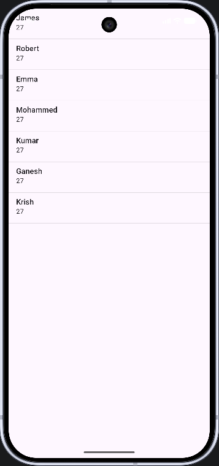
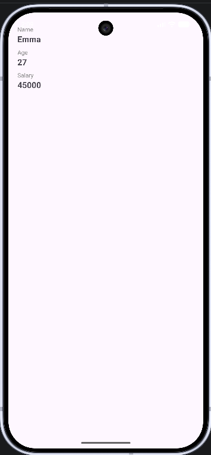

# Employee App

Android app (Java) that reads employee data from a JSON link, shows it in a ListView, and opens a detail screen when an employee is selected.

## Features
- Fetches JSON from https://aamras.com/dummy/EmployeeDetails.json
- Employee list with a loading indicator and an error message if the network fails
- Detail screen showing all fields of the selected employee, with a back button

## Screenshots
| List | Details |
|------|---------|
|  |  |

## How to run
1. Open the project in Android Studio and sync Gradle.
2. Run on an emulator or a phone with internet access.

A ready-to-install APK is included: `EmployeeApp.apk`

## Tech
Java, Android Studio, HttpURLConnection, org.json, ListView

## Author
Priyanka Krishna Punna
